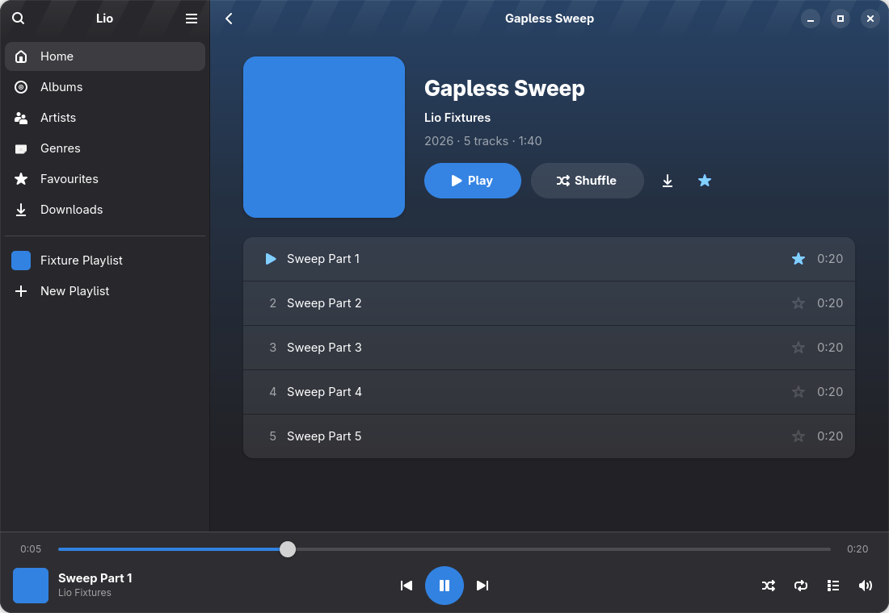

<p align="center">
  
</p>

# lio

**lio** is a fast, native GNOME music player for [Navidrome](https://www.navidrome.org/) - the word itself comes from [lami lioa](https://lamilioa.org) and means 'music', 'rhythm' or 'wave'.



## Features

- **Your whole library, instantly.** The library is mirrored locally, so Lio opens in
  about a second and scrolls smoothly through tens of thousands of albums.
- **Search as you type** across artists, albums and songs, even offline.
- **Gapless playback** with ReplayGain (per track, per album or automatic).
- **Listen offline.** Recently played music is cached automatically (with a size limit
  that removes the least-played songs first), and you can download albums, playlists and
  your favourites. Downloads stay in sync with the server.
- **Play queue** with drag-and-drop, shuffle, repeat, and “save as playlist”.
- **Playlists, favourites and ratings** stay in sync with your server; plays are
  reported (scrobbled) exactly once, including plays made offline.
- **Feels native:** follows the system style and accent colour, works on phones and
  small windows, supports media keys and desktop media controls (MPRIS), and is fully
  keyboard- and screen-reader-accessible.

Lio talks to Navidrome through the Subsonic/OpenSubsonic API. Other compatible
servers may work but aren't tested.

## Install

Lio is meant to be distributed through Flathub (not published yet).

## Build from source

Requirements: Rust ≥ 1.93, GTK ≥ 4.20, libadwaita ≥ 1.8, GStreamer ≥ 1.24 with the base
and good plugins, SQLite with FTS5, glycin loaders, OpenGL ES 3, and `blueprint-compiler`.
The Visualizer view uses libprojectM ≥ 4.1: the system's if pkg-config finds `projectM-4`,
otherwise the bundled copy, which needs CMake and a C++ compiler (see
[`third_party/`](third_party/README.md)).

```sh
git clone --recursive https://github.com/m5ka/lio.git && cd lio

# Development run (resources and settings schema are built by build.rs)
cargo run

# Installed build
meson setup build -Dprofile=development
meson compile -C build
meson install -C build

# Flatpak
flatpak-builder --user --install --force-clean flatpak-build build-aux/dev.m5ka.Lio.Devel.json
```

See [CONTRIBUTING.md](CONTRIBUTING.md) for the project layout, tests and release steps.

## Privacy

Lio only talks to the server you sign in to. Your password is stored in the system
keyring (or the Flatpak secret portal), never in plain text. Signing out deletes your
downloads, cached music and local library copy.

## License

Lio is free software: you can redistribute it and/or modify it under the terms of
the GNU General Public License as published by the Free Software Foundation, either
version 3 of the License, or (at your option) any later version. See [LICENSE](LICENSE).
